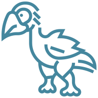

<p align="center">
  <a href="https://animal-generator.net/">
    
  </a>
</p>

<h1 align="center">Animal Generator</h1>

<p align="center">
  Discover your next drawing prompt, classroom topic, or game idea.<br />
  A free random animal generator with reviewed photos and flexible filters.
</p>

<p align="center">
  <strong><a href="https://animal-generator.net/">Try Animal Generator →</a></strong>
  · <a href="#features">Features</a>
  · <a href="#development">Development</a>
  · <a href="https://github.com/Merina041911/animal-generator/issues">Report an issue</a>
</p>

## Overview

Animal Generator helps you explore the animal world one pick at a time. Generate 1–10 animals, narrow the collection by type, habitat, diet, adult size, or native region, and discover species through clear, individually reviewed photographs.

Use it for sketchbook warm-ups, lesson starters, animal guessing games, or a moment of curiosity. Open **[animal-generator.net](https://animal-generator.net/)** to get started—no account or installation required.

## Features

- **Pick one animal or a whole batch.** Generate up to 10 unique species at once.
- **Explore six animal groups.** Mammals, birds, reptiles, amphibians, fish, and invertebrates.
- **Make each pick more specific.** Combine five filter groups: animal type, habitat, diet, adult size, and native region.
- **Keep discovering.** Unseen species are prioritized until the matching pool is exhausted, then a new round begins. A batch never repeats a species.
- **See the whole animal.** Results use photos reviewed for species identity, visibility, and complete main-body framing, displayed without cropping.
- **Use it on desktop or mobile.** A desktop filter toolbar and mobile filter sheet adapt to your screen.
- **Trace the sources.** Public species notes and photo credits document research, attribution, and licensing.

## How to use

1. Visit **[Animal Generator](https://animal-generator.net/)**.
2. Choose how many animals to generate, from 1 to 10.
3. Optionally select filters, then click **Generate animals**.
4. Generate again to discover more, or reset the filters to explore the full collection.

Options within a filter group are combined with **OR**; different groups are combined with **AND**. If fewer species match than you request, the generator returns all available matches.

## Data and photography

The catalog includes 394 species. Only species with approved photos are eligible for random results; the website displays the current available count as the collection grows.

Animal filters are broad discovery aids. Diets, habitats, sizes, and ranges can vary, and uncertain fields are left unassigned rather than guessed. See the **[data sources and species notes](https://animal-generator.net/animal-data-sources)** for measurement conventions, evidence, and limitations.

Photos come from **Wikimedia Commons** and **iNaturalist** and retain their individual licenses. See **[photo credits](https://animal-generator.net/animal-image-credits)** for each photographer, source page, and license. Image reuse must follow the terms of the specific photo.

## Development

Built with HTML, CSS, and vanilla JavaScript. The site runs in the browser with a local animal catalog and optimized WebP photos. No backend, API key, package installation, or build step is required to preview it.

### Preview locally

With Python 3 installed, run:

```bash
git clone https://github.com/Merina041911/animal-generator.git
cd animal-generator
python3 scripts/serve.py
```

Open the preview address printed in your terminal. The preview server supports the same extensionless page routes as the Vercel deployment.

### Run checks

With Node.js installed, run from the repository root:

```bash
node --test animal-generator/tests/*.test.cjs
```

The checks cover filtering, species data, no-repeat behavior, pool exhaustion, source coverage, and photo approval integrity. Review desktop and mobile behavior in a browser before publishing.

### Project structure

| Path | Purpose |
| --- | --- |
| [`animal-generator/index.html`](animal-generator/index.html) | Landing page and generator interface |
| [`animal-generator/animal-generator.js`](animal-generator/animal-generator.js) | Browser interaction and result rendering |
| [`animal-generator/animal-filter-core.js`](animal-generator/animal-filter-core.js) | Filtering and species selection logic |
| [`animal-generator/animal-library.js`](animal-generator/animal-library.js) | Animal catalog and photo metadata |
| [`animal-generator/data/`](animal-generator/data/) | Editable research inputs and source notes |
| [`animal-generator/animal-photos/`](animal-generator/animal-photos/) | Approved photos, attribution manifest, and review records |
| [`animal-generator/tests/`](animal-generator/tests/) | Data and behavior regression checks |
| [`scripts/`](scripts/) | Preview server, data generation, and photo review tools |

For research updates, data regeneration, photo approval, and visual checks, read the **[maintenance guide](docs/MAINTENANCE.md)**.

### Deployment

The production site is hosted on Vercel at **[animal-generator.net](https://animal-generator.net/)**. The static site root is `animal-generator/`; [`vercel.json`](animal-generator/vercel.json) configures extensionless page URLs and removes trailing slashes.

## Feedback and contributions

Found an incorrect animal detail, a photo issue, or a bug? **[Open an issue](https://github.com/Merina041911/animal-generator/issues)** with the species name, what you observed, and a reliable source or screenshot where relevant.

For data or photo changes, follow the [maintenance guide](docs/MAINTENANCE.md), preserve source and license information, and run the checks before opening a pull request.
